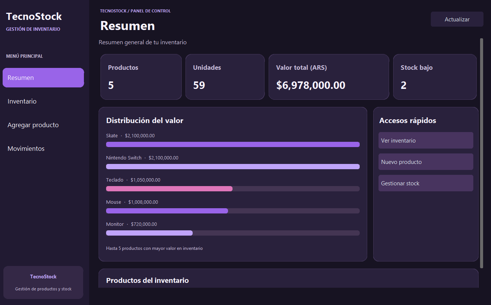
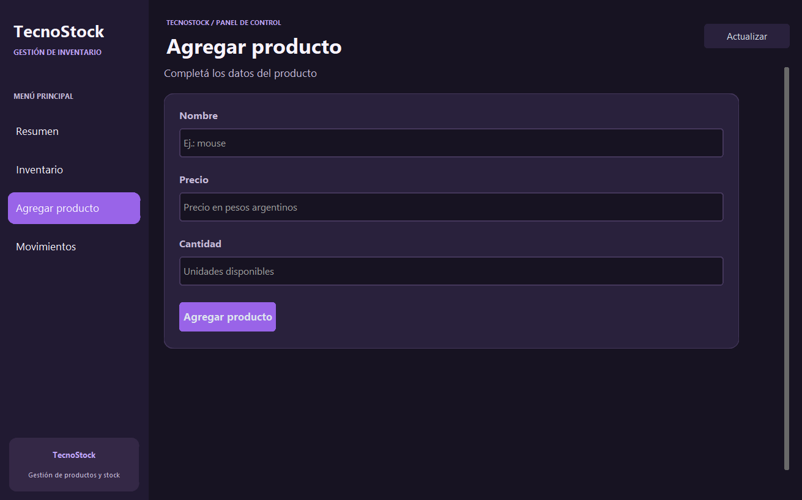
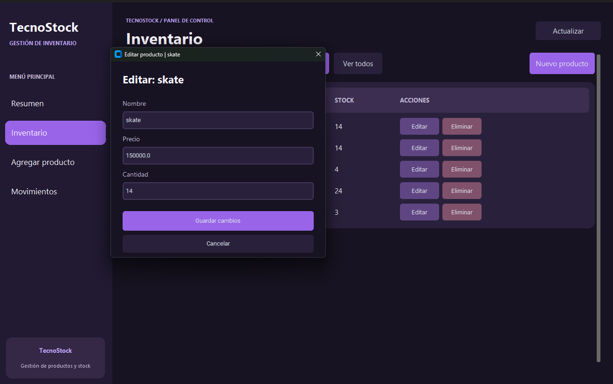

# TecnoStock

Sistema de gestión de inventario desarrollado en Python como proyecto personal.

## Funcionalidades

- Registro y búsqueda de productos.
- Edición y eliminación de productos.
- Control de ingresos y retiros de stock.
- Detección de productos duplicados.
- Estadísticas y visualización del valor del inventario.

## Tecnologías

- Python
- CustomTkinter
- SQLite
- PyInstaller para generar el ejecutable de Windows.

## Capturas

### Inventario

### Agregar productos

### Editar productos

### Movimientos de stock

## Desarrollo

El proyecto comenzó utilizando archivos TXT para almacenar los productos y posteriormente evolucionó hacia una base de datos SQLite.

El código fuente se mantiene en un repositorio privado.

**Desarrollado por Juan Cruz Carrió.**
